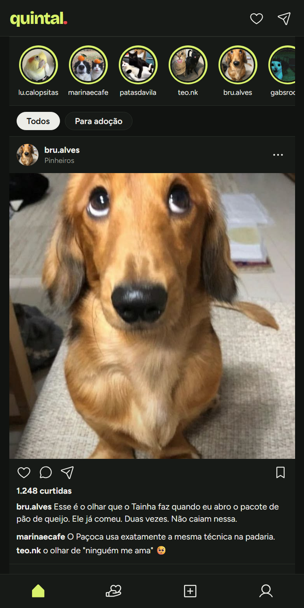

<div align="center">

# quintal.

**Uma rede social para quem ama bicho: tutores, ONGs e animais esperando um lar.**

Feita em React a partir do exercício *"Instagrão: Espelho, espelho meu"* do Instituto PROA.

[](https://viniciusaraujo-coder.github.io/espelho-espelho-meu-main/)


<br>


<br><br>


&nbsp;&nbsp;


<sub>No computador · no celular · e no modo escuro, que liga sozinho junto com o do sistema</sub>

</div>

---

## Sobre a atividade

Este projeto é uma atividade do **Instituto PROA**, em parceria com o **Senac**. A proposta era construir em React um clone da página principal do Instagram, o *Instagrão*.

> **A proposta original, em resumo:**
> - O app precisava **parecer** o Instagram, com posts, comentários e botões para curtir e comentar. Não era obrigatório que nada funcionasse ("mas se quiser, pode").
> - Para não ficar genérico, o conteúdo devia ter um tema: imaginar um feed feito por pessoas que a gente admira, cada uma postando aquilo que mais quer ver.
> - Entregar o link do repositório e prints do resultado.

O projeto base já vinha com um cabeçalho, um componente `Post`, os dados em JSON e os ícones do `react-icons`. Junto vieram **5 desafios sugeridos**:

1. Mudar cores, fonte, logo e textos para uma nova identidade visual.
2. Adicionar, remover ou editar publicações no JSON.
3. Fazer o botão de curtir trocar o ícone e atualizar o número de curtidas.
4. Criar uma área de comentários ou um campo para comentar.
5. Incluir uma tela de perfil ou uma lista de stories.

## A ideia: o quintal

Quando chegou a hora de escolher "as pessoas que eu admiro", o feed virou de **gente que cuida de bicho**. O Instagrão virou o **quintal.**, uma rede social de bairro (Pinheiros, Vila Madalena, Butantã, Perdizes) para:

- 🐶 **tutores** mostrarem a rotina dos seus cães, gatos e aves;
- 🏠 **ONGs e lares temporários** divulgarem animais para adoção;
- 💚 **quem quer adotar** encontrar um bicho e pedir a adoção direto pelo post.

Todas as pessoas são fictícias e têm personalidade própria. O Tainha é um salsicha com ego de dogue alemão, a Célia tem quatro gatos e um sofá destruído, a Nina foi flagrada pela câmera da porta às 3h da manhã...

## O que foi feito

### Os 5 desafios

| # | Desafio | Como ficou |
|:-:|---|---|
| 1 | Nova identidade visual | Nome **quintal.**, com o pontinho vermelho; fontes *Bricolage Grotesque* e *Figtree*; paleta verde e limão; ícones *Phosphor*; **modo escuro automático** |
| 2 | Editar publicações | 12 posts novos, com fotos de verdade, espécie, bairro e informações de adoção |
| 3 | Curtir de verdade | O coração enche e fica vermelho, o número sobe, e **duplo clique na foto também curte**. Ganhou de brinde o botão de **salvar** |
| 4 | Comentários | Lista de comentários em cada post e um campo para publicar o seu |
| 5 | Perfil **e** stories | Fiz os dois. Ver abaixo 👇 |

### E além do que foi pedido

- **Stories como no celular:** agrupados por pessoa, com barrinhas de progresso. Passam sozinhos a cada 5 segundos e emendam no da próxima pessoa. Toque na direita avança e na esquerda volta.
- **Perfil completo:** foto, bio, bairro, pets, números e a grade de fotos (passe o mouse para ver as curtidas). No seu perfil o botão vira "Editar perfil".
- **Seguir pessoas:** pela coluna de sugestões ou pelo perfil. Os dois lugares ficam sempre sincronizados.
- **Posts de adoção:** selo "Para adoção", quadro com nome e informações do bicho e botão **"Quero adotar"**.
- **Filtro do feed:** "Todos" ou só "Para adoção".
- **Nomes clicáveis:** clicar no nome de alguém num post, num comentário ou nas sugestões abre o perfil da pessoa.
- **Versão para celular:** barra de navegação embaixo, com o ícone da tela atual aceso, e respeito à barrinha do iPhone.
- **Publicado no ar** com GitHub Pages, que atualiza sozinho a cada `git push`.

## O que eu aprendi

O projeto foi construído em 7 etapas, seguindo o [manual do quintal](Manual-quintal-React.pdf), que também está neste repositório. Cada etapa trouxe uma ideia nova de React:

| Etapa | O que entrou no app | Conceito de React |
|:-:|---|---|
| 1 | Curtir e salvar | `useState`, eventos (`onClick`, `onDoubleClick`) e valores derivados |
| 2 | Comentários | Formulário controlado (`value` + `onChange`) e o spread `[...lista, novo]` |
| 3 | Avatar e stories | Criar componentes, props com valor padrão e renderização condicional (`&&`) |
| 4 | Sugestões e seguir | **Levantar o estado** e passar funções como props |
| 5 | Os bichos chegam | Dados novos sem reescrever componentes, retorno antecipado e filtro |
| 6 | Perfil | Trocar de "tela" só com estado e ternário, sem biblioteca de rotas |
| 7 | Identidade visual | Variáveis de CSS, `prefers-color-scheme` e `::after` |

A lição que mais ficou: **o que dá para calcular não vira estado**, e **quando dois componentes precisam da mesma informação, ela sobe para o pai**.

## Tecnologias

- **[React 19](https://react.dev/)**: a interface, toda em componentes
- **[Vite](https://vite.dev/)**: servidor de desenvolvimento e build
- **[react-icons](https://react-icons.github.io/react-icons/)**: ícones Phosphor
- **CSS puro**: com variáveis, Grid, Flexbox e media queries, sem framework
- **GitHub Actions + GitHub Pages**: publicação automática

## Estrutura

```
src/
├── App.jsx              # o "cérebro": guarda o estado e decide qual tela mostrar
├── App.css              # estilos dos componentes
├── index.css            # cores (modo claro e escuro) e estilos gerais
├── components/
│   ├── Header.jsx       # logo e ícones do topo
│   ├── Stories.jsx      # a fileira de stories e o story aberto
│   ├── Post.jsx         # um post: foto, curtir, salvar, comentários, adoção
│   ├── Foto.jsx         # a imagem do post (ou um ícone, se não tiver foto)
│   ├── Avatar.jsx       # a bolinha com a foto de perfil
│   ├── Aside.jsx        # coluna da direita: sua conta e sugestões
│   └── Perfil.jsx       # a tela de perfil
└── data/
    ├── posts.json       # os posts
    ├── stories.json     # os stories
    └── usuarios.json    # as pessoas do quintal
public/images/bichos/    # as fotos dos bichos
```

## Como rodar no seu computador

Você precisa do [Node.js](https://nodejs.org/) instalado.

```bash
# 1. baixe o projeto
git clone https://github.com/ViniciusAraujo-Coder/espelho-espelho-meu-main.git
cd espelho-espelho-meu-main

# 2. instale as dependências
npm install

# 3. ligue o servidor
npm run dev
```

Depois é só abrir o endereço que aparecer no terminal, normalmente `http://localhost:5173/espelho-espelho-meu-main/`.

## Créditos

- As **fotos dos bichos** foram tiradas do Pinterest e pertencem aos seus autores. Elas estão aqui só para fins de estudo.
- As **pessoas, ONGs e histórias** do quintal são todas fictícias.
- O projeto base *Instagrão* foi fornecido pelo curso do **Instituto PROA** com o **Senac**.

---

<div align="center">

Feito por **[Vinicius Araujo](https://github.com/ViniciusAraujo-Coder)** · Instituto PROA · 2026

<sub>Licença MIT</sub>

</div>
