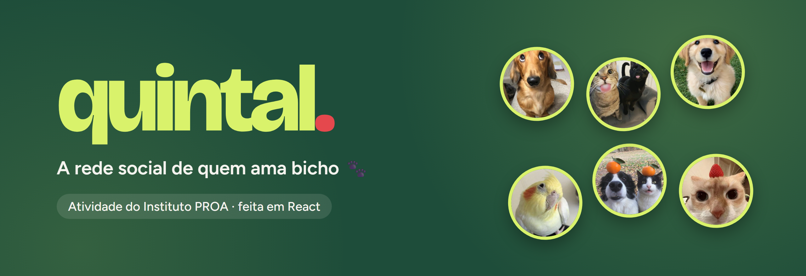
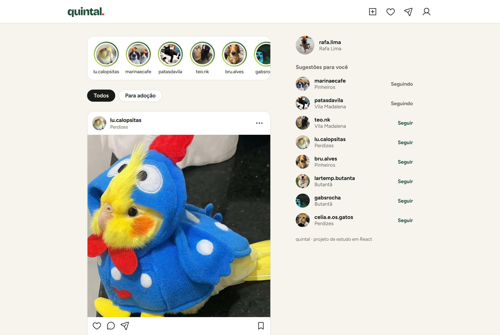
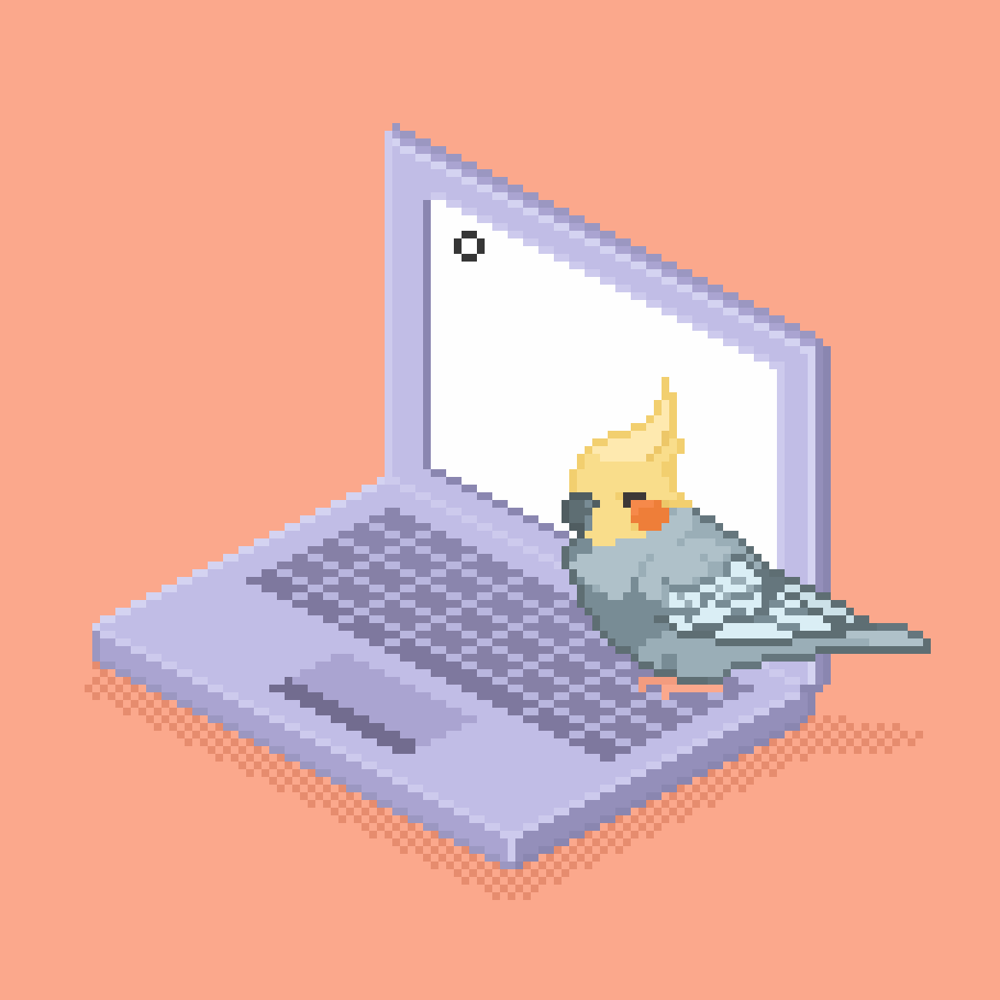

<div align="center">

[](https://viniciusaraujo-coder.github.io/espelho-espelho-meu-main/)


</div>

## ✨ O que dá pra fazer

<table>
  <tr>
    <td align="center" width="33%">❤️<br><b>Curtir e salvar</b><br><sub>até com duplo clique na foto</sub></td>
    <td align="center" width="33%">💬<br><b>Comentar</b><br><sub>e abrir o perfil de quem comentou</sub></td>
    <td align="center" width="33%">⭕<br><b>Stories</b><br><sub>passam sozinhos, igual no celular</sub></td>
  </tr>
  <tr>
    <td align="center">👤<br><b>Perfis</b><br><sub>com pets, bio e botão de seguir</sub></td>
    <td align="center">🏠<br><b>Adoção</b><br><sub>filtre e peça para adotar</sub></td>
    <td align="center">🌙<br><b>Modo escuro</b><br><sub>e versão para celular</sub></td>
  </tr>
</table>

## 📸 Telas

<div align="center">
  
  <br><br>
  
  &nbsp;&nbsp;&nbsp;
  
</div>

## ▶️ Rodar no computador



```bash
npm install
npm run dev
```

<br clear="right">

---

<div align="center">
<sub>Feito por <a href="https://github.com/ViniciusAraujo-Coder">Vinicius Araujo</a> · pessoas fictícias · fotos do Pinterest, só para estudo</sub>
</div>
