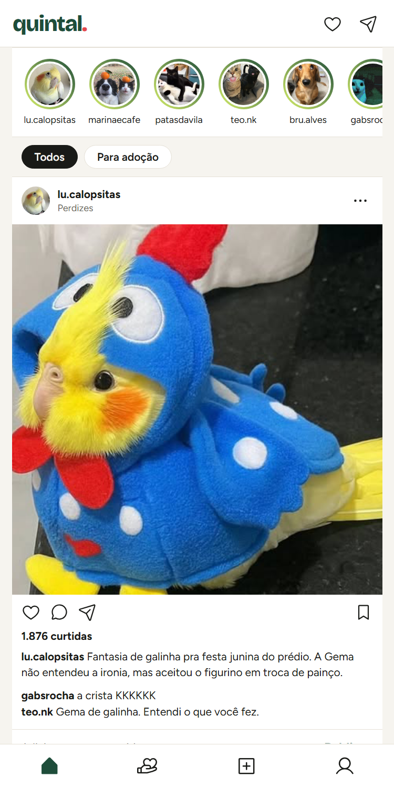

<div align="center">

# quintal.

Rede social para quem ama bicho 🐾 · atividade do **Instituto PROA**, feita em React

[](https://viniciusaraujo-coder.github.io/espelho-espelho-meu-main/)



&nbsp;


</div>

## ✨ O que dá pra fazer

| | |
|:-:|---|
| ❤️ | Curtir (até com duplo clique na foto) e salvar posts |
| 💬 | Comentar |
| ⭕ | Ver stories, que passam sozinhos de uma pessoa para a outra |
| 👤 | Abrir perfis e seguir pessoas |
| 🏠 | Ver os bichos para adoção e pedir para adotar |
| 🌙 | Modo escuro automático e versão para celular |

## 🛠️ Feito com


## ▶️ Rodar no computador

```bash
npm install
npm run dev
```

---

<div align="center">
<sub>Feito por <a href="https://github.com/ViniciusAraujo-Coder">Vinicius Araujo</a> · Pessoas fictícias · Fotos do Pinterest, só para estudo</sub>
</div>
